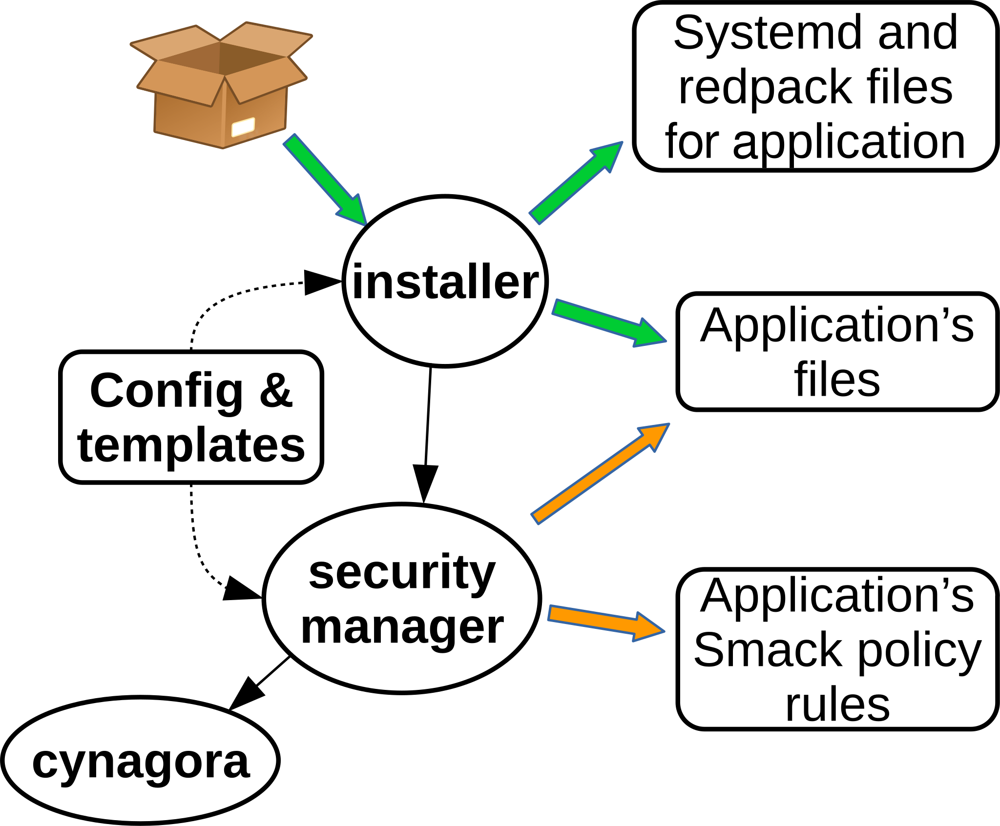

# Application framework of redpesk

## Overview

The application framework of **redpesk**
provides components to install and remove applications
as well as to run them in a secured environment.

The main functionalities are:

- install/remove applications and services

- start/terminate installed applications and services

- answer simple queries: what is installed? what is running?

The application framework fills the gap between the applications
development model and the effective system implementation.

The framework manages applications and hides their security details.
To achieve it, the framework is built on top of security frameworks
of Linux: standard DAC and a MAC module, SELinux and/or Smack.


## The packaging of applications

The application framework of redpesk is only responsible for managing
applications packaged for it.

Applications for the framework are packaged and delivered in a
digitally signed RPM that contains:

* the application and its files: programs, libraries, config, data, ...
* metadata for redpesk framework
   - for newer designs:
      * a `manifest.yml` configuration file in directory `.rpconfig`
      * some signature files in directory `.rpconfig`
   - for framework before arz-1.1
      * a `config.xml` configuration file in root directory
      * some signature files in root directory

The presence of the directory `.rpconfig` (or for older packaging of
`config.xml`) is the key telling that the package is for the framework.
RPMs that do not have this key are standard RPMs.


## Process of installation

When installing a RPM, the system detects if it is a RPM for the
framework or not. When it is a package for the framework, its
metadata are scanned and used for setting up:

1. the DAC and MAC security properties of the installed files
2. the MAC security rules for the package
3. the cynagora permissions granted to the applications
4. the systemd services that setup security and start applications
5. the start dependency graph of applications

The figure below summarizes the process.

{:width="60%"}

The framework ensures that sensitive services, devices and resources
of the platform are protected. Applications can access these sensitive
resources only if explicitly permitted to do so.

Because the redpesk programming model emphasizes a microservices architecture,
the framework also includes descriptions of dependencies on other services.

As of today, this model allows the distribution of HTML and binary applications
but it could be extended to any other class of applications.

```
IN THE FUTURE

Signatures make it possible to grant or deny the permissions
required by an application based on the signers' certificates.

A chain of trust in the creation of certificates allows a hierarchical
structuring of permissions.

This item is 90% implemented.
```

## The security model

The security model refers to how DAC (Discretionary Access Control),
MAC (Mandatory Access Control) and Capabilities are used by the system
to ensure security and privacy.

The application framework uses the security model/framework
to ensure the security and the privacy of the applications that
it manages.

The security framework includes:

- **sec-lsm-manager**: component that interacts with the security module of linux (Smack)
- **sec-cynagora**: component to manage permissions
- **afmpkg-daemon**: component to install and remove packages of the framework
- **redpesk**: RPM plugin that interacts with afmpkg-installer
- **D-Bus** compliant with Cynagora: checks the permissions to deliver messages

**In theory, the security framework/model is an implementation detail
that should not impact the programming model from a user point of view**.

```
IN THE FUTURE

redpesk framework will include self security diagnostic by analyzing audit and log reports.
```

## Systemd services

When applications are installed, the framework creates systemd services
and the dependency graph of the services.

This process, shown on the figure below, uses a configuration file that
can be tuned by implementers.

{:width="60%"}

## Environment setup

Integration of the security framework requires setting up directories,
files and permissions. This setup is done at different stages:

- static setting: during creation of the system

- dynamic settings:
     * during installation of applications
     * at system start-up
     * when a user environment is started

The dynamic settings are made using systemd services of the application framework.
These services are:

- **afm-system-setup.service**: global setup of the system at startup

- **afm-user-session@.service**: starts and holds user's session for one user

- **afm-user-setup@.service**: setups the user's session started by afm-user-session

